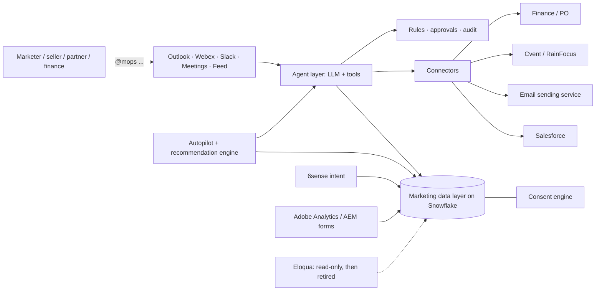

# @mops: architecture & complexity brief (plain English)
*For Srisha, ahead of Chris (Tue 20 Oct 2026) and Saleema. Prepared 18 Oct 2026. Everything about the prototype uses fictional "Northwind Networks" data. Where I say **[estimate]** or **[assumption]**, it is my judgement, not a sourced fact. Where it says **[confirm]**, the owner or IT need to verify the company's actual setup.*

---
## 1. One-paragraph version
@mops is a marketing operator you tag wherever work is discussed. Under the hood it is (1) an **AI agent** that understands the request, (2) **one marketing data layer** (most likely built on the Snowflake warehouse the company already runs) holding accounts, contacts, consent, campaigns, budgets, events, engagement and intent, (3) **agents with "hands"** that act in Salesforce, events, email sending and finance, and (4) **rules, approvals and an audit log** so nothing happens outside policy. It updates every campaign at every stage by itself, recommends the next best move, and does the low-risk work by default. The marketer only approves above set limits.

## 2. Target production architecture (each layer in 1–2 lines)
| Layer | What it is | Plain-English job |
|---|---|---|
| **Tag surfaces** | Outlook add-in / shared mailbox, Webex bot, Slack app, meeting notetaker, plus a simple web feed | You (or a seller, partner, finance) type "@mops …" where you already are. The answer comes back in the same place. |
| **Agent layer** | An LLM (the "brain") plus a fixed set of tools: segment, send, score, sync-doctor, attribute, budget, SOW, event, report | The LLM picks which tool to run; **tools do the actual maths and writes**, so numbers come from data, not from the AI's imagination. |
| **Unified marketing data layer** | Tables on the existing **Snowflake** for accounts, contacts, consent, campaigns, leads, engagement, 6sense intent, Adobe web, opps, budgets | One source of truth. Every agent reads and writes here, which kills re-typing and sync gaps. [assumption: Snowflake is already the marketing warehouse, per the data-flow research] |
| **Connectors** | SFDC (two-way), **Eloqua (read/then retire)**, Cvent/RainFocus, email sending service (e.g. SendGrid/SES/SparkPost), **6sense** (intent in), **Adobe Analytics/AEM** (web data in, forms), finance/PO system, Webex/Outlook | The "hands" and "ears". Each is an API integration owned by IT. |
| **Rules, approvals, audit** | Policy engine (spend limits e.g. $150K, region, who-can-ask-what) + approval cards + append-only log | Decides "do it / ask Srisha / refuse", and records who asked, what was done, data used, and result. |
| **Consent engine** | Per-contact, per-purpose, per-country consent + suppression, checked before every send or export | No email leaves without a lawful basis. Opt-outs honoured everywhere instantly. |
| **Identity & permissions** | Company SSO (Duo/Okta-style), role-based access, service accounts with least privilege | @mops only sees and does what the person tagging it is allowed to. |
| **Autopilot + recommendation engine** | Scheduler that watches data events and advances each campaign's state; scoring models for next-best-action | Makes @mops proactive instead of waiting to be asked (section 3). |

### Replace vs connect vs consume
| Tool | @mops does | Why |
|---|---|---|
| Eloqua | **Replace** (staged: read → run side by side → switch off at renewal) | Email, segments, nurture, scoring, consent move into @mops + a sending service. |
| Power BI / Tableau (marketing reports) | **Replace** for marketing questions | Ask in words, get computed answer + sources. Finance/exec BI can stay. |
| Campaign-code tool, upload tool, SOW templates, budget forms | **Replace** | Become agent jobs. |
| Cvent / RainFocus | **Replace basics** (small events, roundtables); **connect** for big conferences | Large shows need their logistics features. |
| Salesforce | **Connect** (two-way) | Sales' system of record stays. |
| Snowflake | **Build on** | Already there; becomes the data layer. |
| **6sense** | **Consume** (intent, buying stage, predictive scores) **[assumption: license continues]**; its ABM orchestration overlaps with @mops and could be reviewed at renewal | 6sense describes its platform as intent data, predictive buying stages and ABM orchestration ([6sense](https://6sense.com/platform/)). |
| **Adobe Experience Cloud** | **Consume** web analytics + AEM form fills; **connect** AEM for landing pages | [assumption: the company uses Adobe Analytics and AEM for web; whether Adobe Real-Time CDP or Marketo is also in use is **[confirm]**. If Marketo exists in some BU, treat it like Eloqua.] Adobe positions Analytics, AEM and Real-Time CDP as separate products ([Adobe Experience Cloud](https://business.adobe.com/products/experience-cloud.html)). |

## 3. Campaign lifecycle autopilot
**Live state per campaign.** Each campaign carries a state that @mops updates itself as data arrives: **Budget → Setup → Invite → Engagement → Leads → SFDC sync → Opps → Attribution → Report.** Nobody updates a tracker; the thread shows "stage 6/9, here's what changed".

**Agentic ops: done by default (low risk, reversible):** create missing campaign codes, retry/fix failed SFDC syncs, score contacts, write influence records with evidence, clean uploads, refresh reports, draft (not send) seller notes.

**Approval required (above thresholds):** any money movement or budget over limit, sends to new audiences, anything touching consent, seller notifications going out, SOW/PO commitments. One tap in the thread.

**Recommendation engine: signals it uses**
- **6sense:** account intent score, buying stage (e.g. Decision), surging topics.
- **Adobe:** web visits, high-value pages (pricing, contact sales), form fills.
- **Own engagement:** email opens/clicks, webinar and event attendance, content downloads (with time decay).
- **Salesforce:** opp stage, contact roles, seller ownership, recent activity.
- **Money:** budget, spend, pipeline per dollar by campaign/channel/region.
- **Consent:** who can be emailed vs. only called.

**What it recommends:** next best action per campaign/account (add in-market accounts, invite to the next event), budget shifts toward higher pipeline-per-dollar plays, who sellers should follow up this week, and stalled stages (e.g. "leads not synced").

**Guardrails:** recommendations show their evidence (record IDs); money never moves without approval; no credit without evidence; rate limits so it doesn't spam threads (it only posts when something changes); every auto-action logged and reversible; a weekly "what autopilot did" digest for Srisha.

## 4. The real complexities and how to handle each
| # | Complexity | Why it's hard | How we handle it |
|---|---|---|---|
| 1 | **Data access & IT/security approvals** | Reading CRM/Eloqua/Snowflake data with PII needs InfoSec review, data-classification sign-off, service accounts, and an approved AI model/endpoint. Usually the longest pole. | Start **read-only** on one region; use the company's approved AI platform and company-hosted data; least-privilege service accounts; ask for a named IT/security partner on day 1. [estimate: approvals can take several weeks; plan for it] |
| 2 | **Consent & privacy law** | **GDPR** needs a lawful basis (Art. 6) and demonstrable, withdrawable consent (Art. 7) ([Art 6](https://gdpr-info.eu/art-6-gdpr/), [Art 7](https://gdpr-info.eu/art-7-gdpr/)). **India DPDP Act 2023 + Rules** notified 13 Nov 2025 with an 18-month phased timeline; requires clear standalone consent notices; Board penalties up to ₹250 crore ([PIB](https://www.pib.gov.in/PressReleasePage.aspx?PRID=2190014), [Gazette timeline](https://dpdpa.in/notification_timeline_act.pdf), [Lok Sabha answer](https://sansad.in/getFile/lsapps/loksabhaquestions/annex/188/AU3943_458sox.pdf)). **CAN-SPAM** (US): honest headers/subjects, physical address, working opt-out honoured within 10 business days ([FTC guide](https://www.ftc.gov/business-guidance/resources/can-spam-act-compliance-guide-business)). Plus APAC laws (Australia Spam Act, Singapore PDPA, Japan APPI) **[confirm with Legal]**. | A consent engine that stores consent per purpose and country, migrated from Eloqua **first** and reconciled; hard-block sends without consent (prototype already suppresses); Legal/Privacy review before any live send; Privacy team owns the rules, @mops enforces them. |
| 3 | **Email deliverability when leaving Eloqua** | Inbox placement depends on domain and IP reputation built over years. Gmail requires bulk senders (5,000+/day) to have SPF, DKIM, DMARC, keep spam rate under 0.3% (ideally under 0.1%), and support one-click unsubscribe ([Gmail guidelines](https://support.google.com/mail/answer/81126?hl=en), [FAQ](https://support.google.com/mail/answer/14229414)). A new IP/subdomain with no history gets filtered. | Use an enterprise sending service; **warm up** a dedicated subdomain/IP gradually with the most engaged opted-in contacts; set up authentication with IT; monitor Postmaster Tools; keep Eloqua sending in parallel until metrics match. Eloqua is the **last** thing switched off. |
| 4 | **SFDC sync & duplicates** | Today Eloqua imports run every 15 min and stop after 20 consecutive failures (see data-flow.md). Duplicates, locked records, validation rules and API limits cause silent failures ([Salesforce API limits](https://developer.salesforce.com/docs/atlas.en-us.salesforce_app_limits_cheatsheet.meta/salesforce_app_limits_cheatsheet/salesforce_app_limits_platform_api.htm)). | One matching key (email + domain → account), merge-before-insert, idempotent writes, the **sync doctor** (built in prototype) that explains, fixes and escalates, and alerts instead of silent stops. Sales Ops owns CRM rules. |
| 5 | **Attribution logic** | Everyone fights over credit. Salesforce custom influence models often need manual records or code ([Salesforce Campaign Influence guide](https://resources.docs.salesforce.com/latest/latest/en-us/sfdc/pdf/campaign_influence_implementation_guide.pdf)). | Agree the model up front with Sales Ops/Finance (prototype uses evidence-only, even-split, and shows first/last touch); @mops never credits without evidence; one model, published. |
| 6 | **LLM accuracy / hallucination** | LLMs can sound confident and be wrong. | The LLM **chooses tools; tools compute numbers**; every answer cites record IDs; writes go through rules; evaluation test-set before go-live; human approval on high-impact actions. Aligns with NIST AI RMF ([NIST](https://www.nist.gov/itl/ai-risk-management-framework)). Prototype runs on fixed rules today; real AI not yet tested (no key). |
| 7 | **Audit trail** | Finance, Legal and Internal Audit will ask "who approved this spend/send, and why?" | Append-only log of request → plan → approval → action → result, with data used; exportable; retention per company policy **[confirm]**. |
| 8 | **Change management** | MOps, agencies and regional teams are used to their tools and tickets; some roles change. | Pitch as removing repetitive work, not people; champions in the pilot region; side-by-side running; show time saved weekly; retrain MOps as "agent supervisors". |
| 9 | **Vendor contracts** | Eloqua, Cvent, BI licences have renewal dates and notice periods; early exit can cost money. | Get the renewal calendar from Procurement **[confirm]**; switch off each tool at its renewal once @mops matches it; keep 6sense/Adobe as data sources. |
| 10 | **Cost** | LLM usage, sending service, Snowflake compute, integration engineering, support. | Pilot cost is mainly people + cloud usage; compare against licence savings at renewal. I have **not** priced the company's licences; any savings figure must come from Procurement. [estimate: LLM cost per request is small vs. engineering cost; to be measured in pilot] |

## 5. Staged 90-day pilot (one region, e.g. India) [estimate]
| Days | Stage | What happens | Exit test |
|---|---|---|---|
| 0–15 | **Approvals & read-only connect** | Security/privacy review; read access to SFDC, Eloqua, Snowflake, 6sense, Adobe for one region; SSO. | Data visible in @mops, matches source within agreed tolerance. |
| 16–45 | **Ask & recommend (read-only)** | Reports, who's hot, sync diagnosis, attribution suggestions, autopilot recommendations. No writes. | Marketers use it weekly; answers match BI. |
| 46–75 | **Low-risk writes with approval** | Campaign codes, sync fixes, CRM tasks for sellers, uploads, budget/SOW drafts. Old tools still running. | Zero data incidents; time saved measured. |
| 76–90 | **Side-by-side sends + decision** | Small warmed-up email sends to opted-in contacts in parallel with Eloqua; leadership readout. | Deliverability ≥ Eloqua baseline; decision to expand. |

**Metrics to time live:** hours saved per marketer per week, time from "plan" to "campaign live", % leads synced first time, consent incidents (target zero), pipeline per dollar. Baselines to be measured in weeks 1–2, not assumed.

## 6. Team needed (roles, not headcount promises)
Executive sponsor (Saleema) · Product owner (Srisha) · Marketing ops lead (domain + consent rules) · 1–2 integration engineers (SFDC/Snowflake/APIs) · AI/agent engineer · Data engineer (Snowflake models) · Security & privacy partner · Sales Ops partner (CRM rules, attribution) · Deliverability specialist (part-time) · Pilot-region champion marketers · Procurement contact (renewals).

## 7. Top 10 tough questions Saleema may ask, with crisp answers
1. **"Why not just buy Salesforce Agentforce or Adobe's agents?"** They're built around their own stacks. We'd be connecting more tools, not removing them. @mops sits on our Snowflake data and our rules; we can still use vendor models underneath.
2. **"Is this safe with customer data?"** Read-only first, an approved AI endpoint, SSO, least-privilege access, consent engine blocks sends, full audit log. Security signs off before any write.
3. **"What if the AI makes a mistake?"** The AI chooses actions; tools compute the numbers from data and cite sources. Money, sends and consent changes always need human approval.
4. **"How do we not break email deliverability?"** Warm a dedicated subdomain gradually, meet Gmail/Yahoo sender rules, run alongside Eloqua; Eloqua goes last.
5. **"What does it cost and what do we save?"** Pilot = a small team + cloud usage for 90 days. Savings come from tools switched off at renewal plus marketer hours. Exact numbers need Procurement's licence data; we'll measure hours in the pilot rather than guess.
6. **"Who owns this: Marketing or IT?"** Marketing owns the product and rules; IT owns integrations, security and hosting. Same model as other internal platforms.
7. **"What about GDPR / DPDP?"** Consent is stored per purpose and country and checked before every send; DPDP obligations phase in over 18 months from Nov 2025, so building it right now is timely. Legal reviews the rules.
8. **"Won't 6sense/Adobe/Cvent overlap?"** 6sense and Adobe become signal sources feeding recommendations; event tools stay for big conferences. We replace what duplicates work.
9. **"How is this different from Cloud Control?"** Same principles (one data layer, agents, human approval) applied to our own marketing. Cloud Control connects customers' stacks; internally we own ours, so we can replace.
10. **"What do you need from me?"** Sponsorship, a pilot region, a named IT/security partner, and access to read-only data for 90 days.

## 8. Prototype status (fictional data, rule mode)
All 10 data-flow tags work end-to-end: budget, campaign + code, event, invite with consent check, uploads, **sync doctor (#6)**, **who's hot with 6sense + Adobe signals (#7)**, **evidence-based attribution (#8)**, reports (#9), **push target list to sellers (#10)**, plus **autopilot** (live stage per campaign, auto low-risk fixes, recommendations with approve buttons). 47 automated checks pass. Real AI not yet tested (needs a key); CRM, 6sense, Adobe and Webex are mocks.

## 9. Full martech inventory: to confirm with Srisha
Likely in the stack (**[assumption]**, typical for large B2B tech companies; confirm what field marketing actually uses):
- Eloqua (email/automation), possibly Marketo in some teams
- Salesforce Sales Cloud (+ Campaign Influence)
- Snowflake; Fivetran/Informatica/MuleSoft for data movement; Census/Hightouch reverse ETL
- Power BI / Tableau
- 6sense (intent, ABM); possibly Demandbase, Bombora or ZoomInfo/LinkedIn Sales Navigator for data
- Adobe Analytics, AEM (web/forms), possibly Adobe Real-Time CDP / Target / Workfront (work management)
- Cvent, RainFocus, ON24/Webex Webinars, Webex Events
- LinkedIn Campaign Manager, Google Ads, The Trade Desk / programmatic
- Partner portal / MDF system (e.g. Impartner, Zift, or internal), Partner Relationship Management
- Finance/PO: SAP Ariba or Coupa **[confirm]**
- Consent/preference centre: OneTrust or TrustArc **[confirm]**
- Content/DAM: Adobe AEM Assets, Seismic/Highspot (sales enablement)
- Collaboration: Webex, Outlook, Slack, SharePoint/Box
