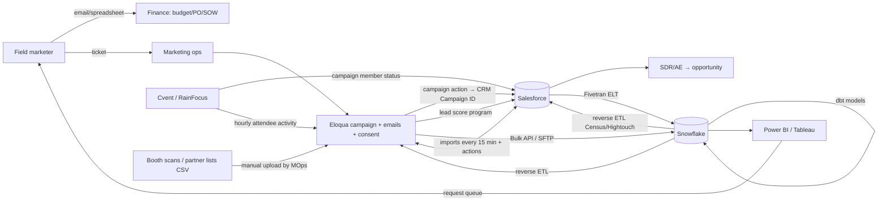

# @mops: how field-marketing data moves today, and where you tag @mops

This uses public vendor documentation only. It contains nothing from internal company systems. Notes marked **[practitioner]** describe common industry patterns and don't come from a vendor document.

## 1. Today's flow, step by step

| # | Step | Who does it | How it works today (source) |
|---|------|-------------|-------------------------------|
| 1 | Budget / plan approved | Field marketer → finance | Spreadsheet and email, then a PO or SOW **[practitioner]** |
| 2 | Campaign + campaign ID created | Marketing ops (MOps) | The Eloqua campaign has "Sync with CRM" turned on. The SFDC Campaign ID fills in only after the first sync. A campaign action pushes status changes to SFDC, with up to 249 mapped fields and only one campaign action per connection. https://docs.oracle.com/en/cloud/saas/marketing/eloqua-user/Help/Apps/SalesforceApp/Tasks/CreatingCampaignActions.htm |
| 3 | Event built | Event marketer / agency | The Cvent event is linked to the SFDC campaign, and attendee statuses map to campaign-member statuses. https://developers.cvent.com/docs/cvent-salesforce-app/manage-event-campaigns · Cvent can auto-create SFDC campaigns per event. https://developers.cvent.com/docs/cvent-salesforce-app/event-campaign-configuration · RainFocus has native SFDC and Eloqua integrations. https://www.rainfocus.com/resources/faqs/ |
| 4 | Invites / nurture sent | MOps (Eloqua build) | Eloqua email programs. Consent and subscription status are held in Eloqua **[practitioner]** |
| 5 | Attendees / leads land | Event tool sync or **manual CSV** | Cvent → Eloqua attendee activities go into a custom object, syncing **hourly**, as a paid add-on. https://support.cvent.com/s/communityarticle/Using-Attendee-Activity-Data-in-Eloqua · Booth scans and partner lists are uploaded as CSVs by MOps **[practitioner]** |
| 6 | Eloqua ⇄ SFDC sync | Automatic | Imports from SFDC run **every 15 min**, with dedupe rules per run. An import **stops after 20 consecutive failures** until someone re-saves it. https://docs.oracle.com/en/cloud/saas/marketing/eloqua-user/Help/Apps/SalesforceApp/Tasks/CreatingCampaignImports.htm · Integration overview: https://docs.oracle.com/en/cloud/saas/marketing/eloqua-user/pdf/OracleEloqua_Salesforce_IntegrationGuide.pdf |
| 7 | Lead score → SFDC | MOps | An Eloqua "SYSTEM – Update Lead Score in CRM" program writes the score to the SFDC Lead or Contact. https://docs.oracle.com/en/cloud/saas/marketing/eloqua-user/Help/CRMIntegration/LeadScoring/Tasks/CreatingAProgram.htm |
| 8 | Sales works the lead → opportunity | SDR / AE, sales ops | Campaign influence is attributed in SFDC. Under a custom model, influence records are **created manually** or by Apex. https://help.salesforce.com/s/articleView?id=sales.campaigns_influence_customizable_manage_parent.htm&language=en_US&type=5 · https://resources.docs.salesforce.com/latest/latest/en-us/sfdc/pdf/campaign_influence_implementation_guide.pdf |
| 9 | Load to Snowflake (ELT) | Data engineering | Fivetran's SFDC connector loads to the warehouse. https://www.fivetran.com/connectors/salesforce · Eloqua data comes out through Bulk API 2.0, REST or SFTP into Snowflake. https://www.pedowitzgroup.com/eloqua-integrate-with-bi-tools · Informatica or MuleSoft are common alternatives **[practitioner]** |
| 10 | Transform / attribution model | Data / BI team | dbt or SQL models join Eloqua activity to SFDC opportunities. (Same Pedowitz source.) |
| 11 | Dashboards | BI analysts | Power BI or Tableau read the curated Snowflake datasets. (Same Pedowitz source.) |
| 12 | Reverse ETL back | Data engineering | Snowflake → SFDC through Fivetran Activations (formerly Census). https://www.fivetran.com/blog/how-to-move-data-from-snowflake-to-salesforce · Snowflake → Eloqua through Hightouch, as often as once a minute. https://hightouch.com/integrations/snowflake-to-eloqua |



## 2. Pain points
1. **Sync lag and silent failures.** Imports run on a 15-min cycle, Cvent attendee activity syncs hourly, and an import stops after 20 failures until someone notices (Oracle docs above).
2. **The campaign ID appears late.** It exists only after the first sync, so event and email builds wait on it. Mismatched or hand-typed codes break attribution **[practitioner]**.
3. **Manual CSV uploads.** Booth scans and partner lists need field mapping and dedupe. Unmatched registrants show up as "unattributed attendees" (RainFocus blog: https://www.rainfocus.com/blog/salesforce-integration-conversations-marius-milcher/).
4. **Duplicate leads.** Dedupe runs per import execution and only on a chosen match field (Oracle docs).
5. **Attribution gaps.** Custom influence models need manual records or Apex (Salesforce docs). Offline events and partner touches often go missing **[practitioner]**.
6. **Waiting on people.** The marketer files a ticket to MOps for builds and uploads, and asks BI for reports. Dashboards refresh on the warehouse schedule **[practitioner]**.

## 3. @mops: tag points at every step

| # | Who tags, where | Example tag | What @mops does | Legacy hop it removes |
|---|------|-----|------|------|
| 1 | Marketer, in Webex/email | `@mops budget for a Q3 ABM play, India enterprise, $90K` | Drafts the budget request from pipeline data, routes it within the $150K rule and drafts the SOW | Spreadsheet → email → finance chase |
| 2 | Marketer | `@mops create the campaign and sync to SFDC` | Makes **one** campaign record, generates the code, writes it to the CRM immediately and reuses it everywhere | MOps ticket, waiting for CRM ID, hand-copied codes |
| 3 | Event owner | `@mops set up the Bangalore CIO roundtable, 40 seats` | Builds the event and registration page, already linked to the campaign | Cvent build + link-to-campaign mapping |
| 4 | Marketer | `@mops invite opted-in CIOs in South India, 3-step nurture` | Builds the segment, suppresses anyone without consent, sends and runs the nurture | Eloqua segment/program build |
| 5 | Marketer, on-site | `@mops upload these booth scans` (drop the CSV) | Cleans, dedupes and matches to accounts, flags exceptions, then writes to the campaign | Manual CSV import, field mapping, unattributed attendees |
| 6 | Marketer / seller | `@mops why didn't these leads reach SFDC?` | Reads its own sync and audit log and explains: no consent, a duplicate, or a failed rule | 15-min sync + ops investigation |
| 7 | Seller, in their CRM chat | `@mops who's hot at Acme?` | Gives the score with reasons and recent touches | Score program + field mapping |
| 8 | Sales ops / seller | `@mops credit the roundtable on this opp` | Writes the influence record from attendance plus contact roles | Manual influence records / Apex |
| 9–11 | VP / marketer | `@mops pipeline from last quarter's ABM by region` | Queries the single data layer and returns numbers, a chart and the cited records | ELT → dbt → dashboard → analyst queue |
| 12 | Anyone | `@mops push the target-account list to sellers` | Writes the list straight into the CRM as a task or view | Reverse ETL job |

```mermaid
flowchart LR
  subgraph Tag["Tag @mops anywhere: Webex · email · Slack · meeting · CRM"]
    T1[1 budget/SOW] --- T2[2 campaign+code] --- T3[3 event] --- T4[4 invite/nurture]
    T5[5 upload list] --- T6[6 why not in SFDC?] --- T7[7 who's hot] --- T8[8 credit opp] --- T9[9 pipeline by region] --- T10[10 push list]
  end
  Tag --> BRAIN[@mops brain + rules: consent, $150K approval]
  BRAIN --> AG[Agents: Ops · Email · Event · Insight]
  AG <--> DL[(ONE data layer: accounts, contacts+consent, campaigns+codes, events, leads, budgets, influence)]
  AG -->|real-time write, phase 1 only| SF[(Salesforce: sales keeps it)]
  DL -->|answer + artifact on the thread| Tag
```

**What gets switched off:** Eloqua (2, 4, 6, 7), Cvent/RainFocus basics (3, 5), the CSV upload process (5), the Snowflake → dbt → Power BI/Tableau marketing reporting chain (9–11) and reverse ETL (12). Salesforce stays as the sales system and is written to in real time. In phase 1 @mops can also read from Snowflake while the old tools run in parallel.

**Prototype status:** tags 1, 2, 3, 4, 5 and 9 already exist in agents.js (budget_request, create_campaign_code, create_event, build_segment/send_email/schedule_nurture, clean_upload, query_insight). Tags 6, 7, 8 and 10 are new tools still to build.

## Addendum (18 Oct): Adobe and 6sense in the flow
**[assumption]** The company uses Adobe Analytics + AEM for web, and 6sense for intent/ABM. Confirm with the owner.

| Source | What moves | Where it goes today (typical) | With @mops |
|---|---|---|---|
| 6sense | Account intent score, buying stage, surging keywords, predictive scores | Into SFDC fields and sometimes Eloqua segments; ABM ads run inside 6sense ([6sense platform](https://6sense.com/platform/)) | **Consumed** into the data layer and fed to scoring, target lists and autopilot recommendations. 6sense ABM orchestration is reviewed at renewal. |
| Adobe Analytics | Web visits and page views (pricing, contact sales) | Into the warehouse for BI; identity stitched via Eloqua cookies/forms **[practitioner]** | **Consumed**; high-value pages weigh more in scoring. |
| Adobe AEM | Landing pages and forms | Form posts into Eloqua | **Connect**: forms post to @mops (consent captured on submit). |
| Adobe RT-CDP / Marketo (if present) | Profiles / automation | **[confirm]** | Treat like Eloqua: read, then replace if duplicative. |

```mermaid
flowchart LR
  SIX[6sense intent + stage] --> DL[(@mops data layer on Snowflake)]
  ADB[Adobe Analytics web visits] --> DL
  AEM[AEM forms] --> DL
  DL --> REC[Recommendation engine + autopilot]
  REC -->|tasks + notes| SF[(Salesforce)]
  REC -->|approve?| FM[Field marketer thread]
```
In the prototype, both are mock tables (`intent6s`, `adobeWeb`) used by "who's hot", the target list ranking and autopilot's "in-market accounts" recommendation.
